<div align="center">


# Daybloom

**See your day. Feel the time.**

A visual day planner and timer for macOS and Windows.<br>
Your day is a dial. Each block is an arc on the ring, and the orange hand is now.

[](https://github.com/alshell7/daybloom-releases)


[**Download for macOS**](https://github.com/alshell7/daybloom-releases#macos-apple-silicon--intel) &nbsp;·&nbsp; [**Download for Windows**](https://github.com/alshell7/daybloom-releases#windows) &nbsp;·&nbsp; [Guide](#guide) &nbsp;·&nbsp; [Build from source](#for-developers)

<br>

<picture>
  <source media="(prefers-color-scheme: dark)" srcset="docs/media/hero-dark.png">
  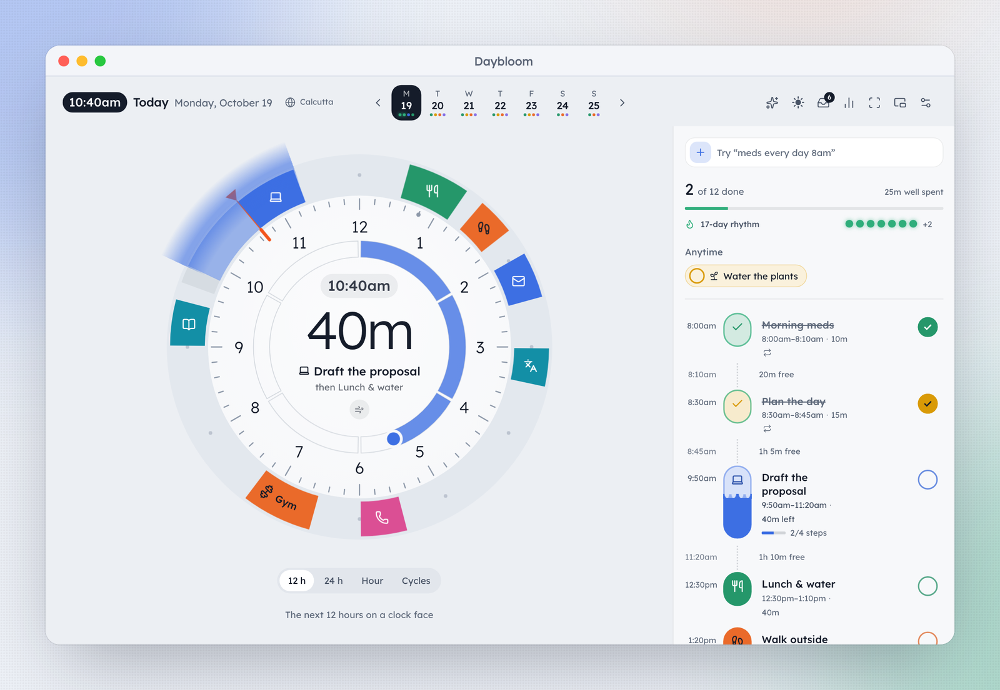
</picture>

</div>

<br>

## See it move

<div align="center">
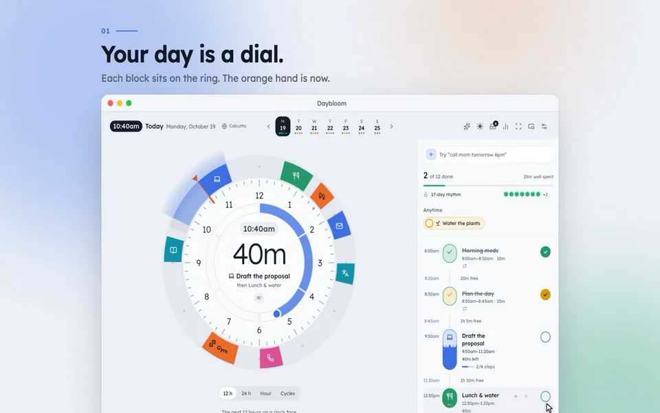
<br>
<sub>The animation does not play? <a href="docs/media/demo.mp4">Watch the video (MP4, 71 s)</a>.</sub>
</div>

<br>

## Contents

- [What Daybloom does](#what-daybloom-does)
- [Install](#install)
- [Guide](#guide): [the dial](#read-the-dial), [add blocks](#add-a-block), [change blocks](#change-a-block), [finish blocks](#finish-a-block), [backlog](#use-the-backlog), [assistant](#ask-daybloom), [voice](#talk-to-daybloom), [your week](#see-your-week), [gentle support](#get-gentle-support), [focus sessions](#start-a-focus-session), [screen cues](#use-screen-cues), [privacy mode](#use-privacy-mode), [addons](#use-addons), [Work](#bill-your-time-with-work), [Time Tracker](#track-your-time), [Breadcrumbs](#leave-breadcrumbs), [Make it smaller](#make-a-task-smaller), [Reality check](#plan-with-real-times), [Waqt](#keep-salah-times-with-waqt), [MCP](#connect-ai-apps-with-mcp), [Alef](#meet-alef), [AI](#set-up-ai), [help to start](#get-help-to-start), [alarms](#set-an-alarm), [world clock](#compare-time-zones), [Trash](#restore-from-the-trash), [top bar](#choose-the-top-bar-buttons), [done](#see-what-youve-done), [month](#see-the-month), [start fresh](#start-fresh), [Board and Gantt](#see-the-timeline-as-a-board-or-a-gantt-chart), [Soft landings](#land-softly-after-meetings), [Retrospection](#look-back-with-retrospection), [widget](#use-the-desktop-widget), [themes](#change-the-theme), [time zones](#change-the-time-zone), [calendars](#connect-calendars), [sync](#sync), [shortcuts](#keyboard-shortcuts)
- [Your data](#your-data)
- [For developers](#for-developers)

<br>

## What Daybloom does

<table>
<tr>
<td width="50%" valign="top">

### Time you can see
The ring shows your blocks as arcs. The remaining time of a block shows as a shrinking ring and a countdown. You do not have to calculate.

</td>
<td width="50%" valign="top">

### Four ways to read the dial
**12 h** shows the next 12 hours. **24 h** shows the whole day. **Hour** shows one hour as a wedge. **Cycles** shows focus rounds with breaks.

</td>
</tr>
<tr>
<td colspan="2">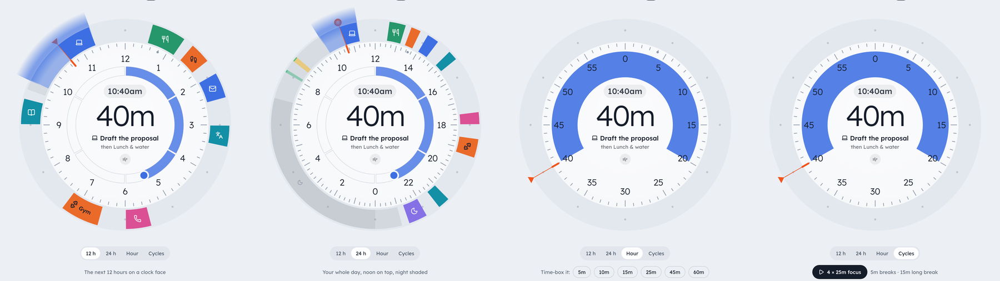</td>
</tr>
<tr>
<td valign="top">

### Plan in plain words
Type “gym 5pm 45m” or “standup weekdays 9:30 15m”. A preview shows what Daybloom understood before you press Enter.

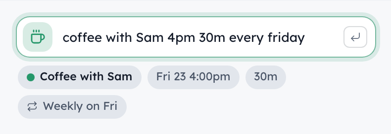

</td>
<td valign="top">

### Details on hover
Move the pointer over an arc. A card shows the times, the time left and the next step.

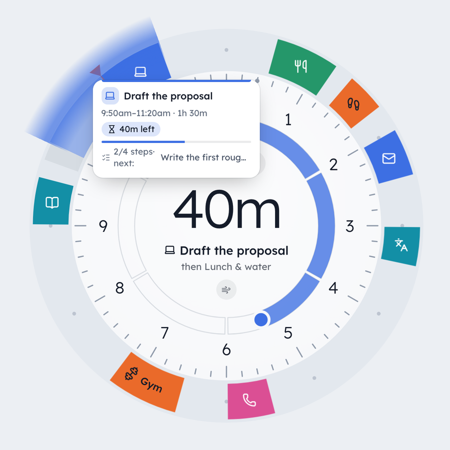

</td>
</tr>
<tr>
<td valign="top">

### A backlog for later
Put tasks in **Inbox**, **Next** or **Someday**. Give them a priority and a due date. Drag one onto the dial to schedule it.

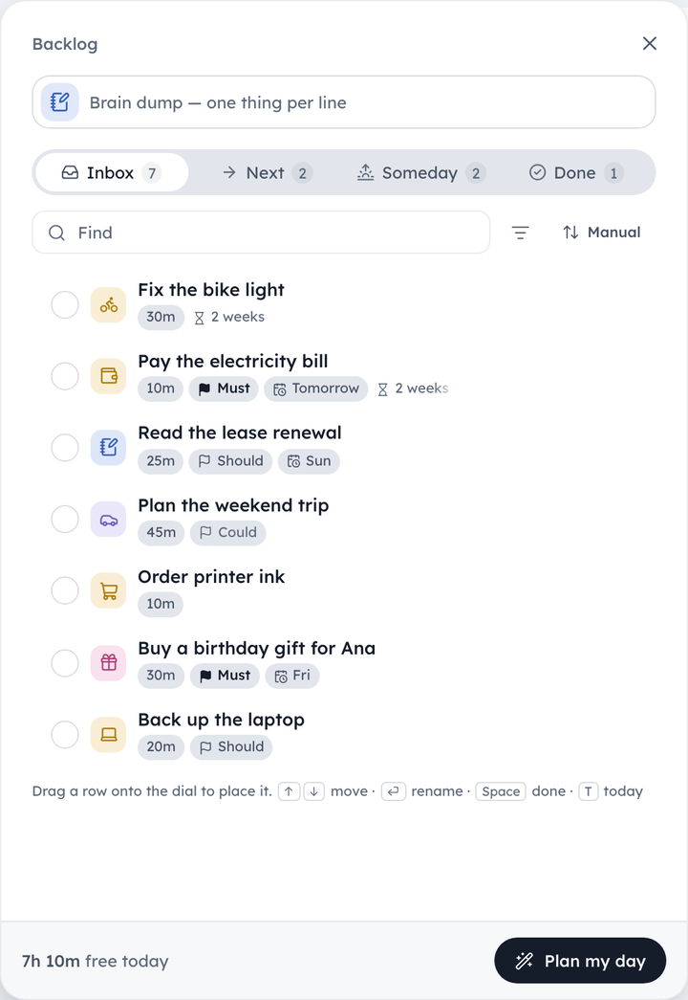

</td>
<td valign="top">

### Ask in your own words
Ask “plan my day” or “what's next”. The assistant answers with cards that you can use. It runs on your computer.

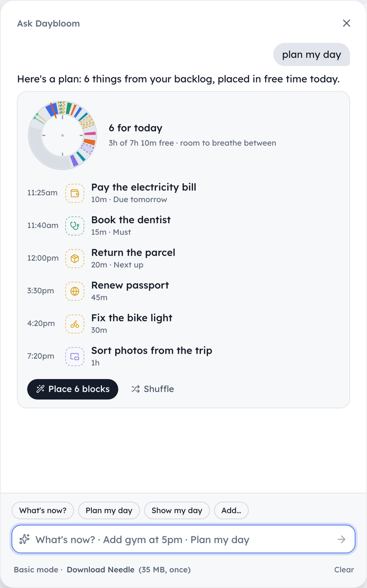

</td>
</tr>
<tr>
<td valign="top">

### Your week and your rhythm
See what you finished this week. A rhythm counts the days on which you finished something. A rest day can cover a missed day.

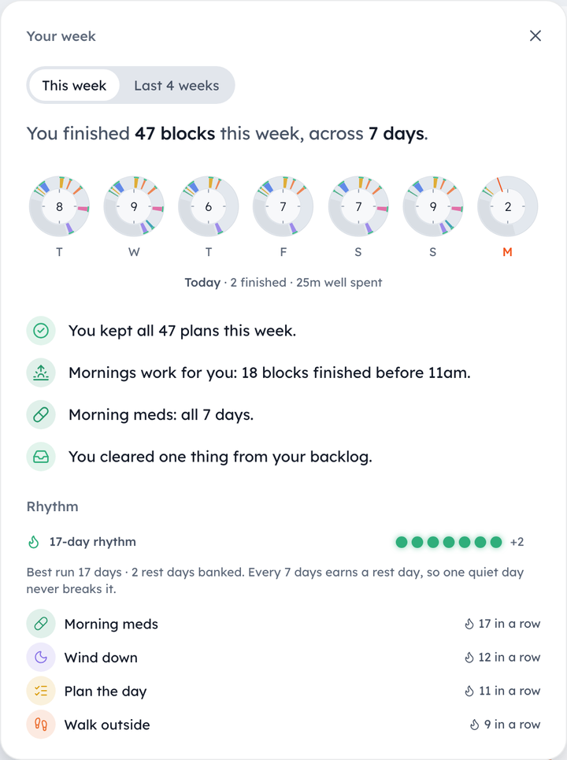

</td>
<td valign="top">

### Focus on one thing
Focus mode shows only the session, the steps of the task and the next block.

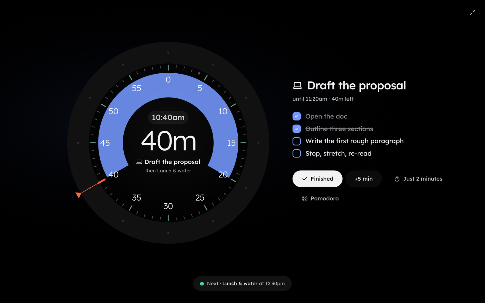

<br><br>

### Twenty themes
Nine light themes and eleven dark themes, including true black, and twenty dial finishes to match.

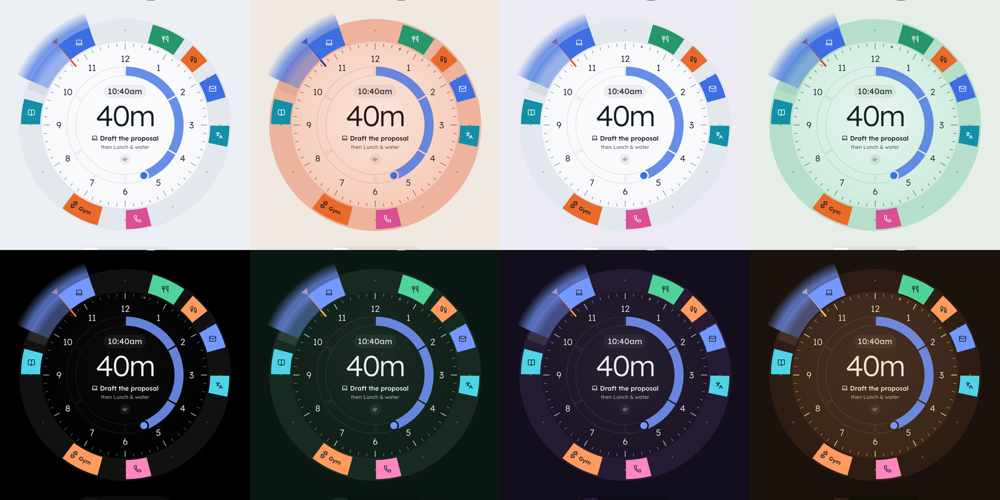

</td>
</tr>
<tr>
<td valign="top">

### Just say it
Hold <kbd>V</kbd> and talk. Your words appear as you speak, and the assistant acts on them when you stop. Speech recognition runs on your computer.

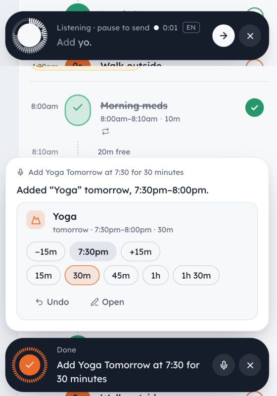

</td>
<td valign="top">

### Focus your way
Pick what to focus on and turn the dial to any length, from 1 minute to 2 hours. Use one stretch, or cycles with breaks.

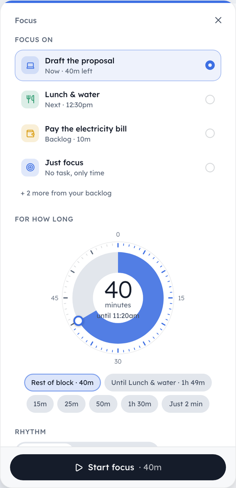

</td>
</tr>
<tr>
<td colspan="2" valign="top">

### Cues at the edge of your screen
An optional edge glow breathes in the colour of the task, and breathes faster near the end. A thin time bar drains on the edge that you choose. A small HUD shows the time left in a corner. None of them take a click.

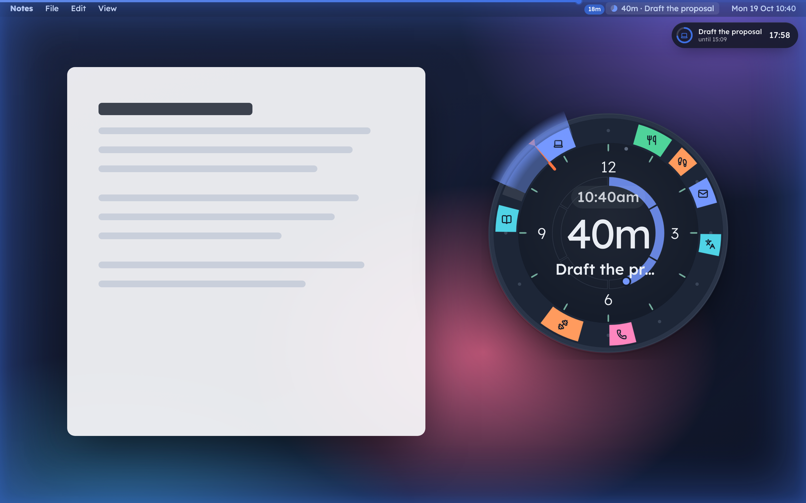

</td>
</tr>
<tr>
<td valign="top">

### Addons
Switch on new powers when you need them. Your day stays as it was when you switch one off.

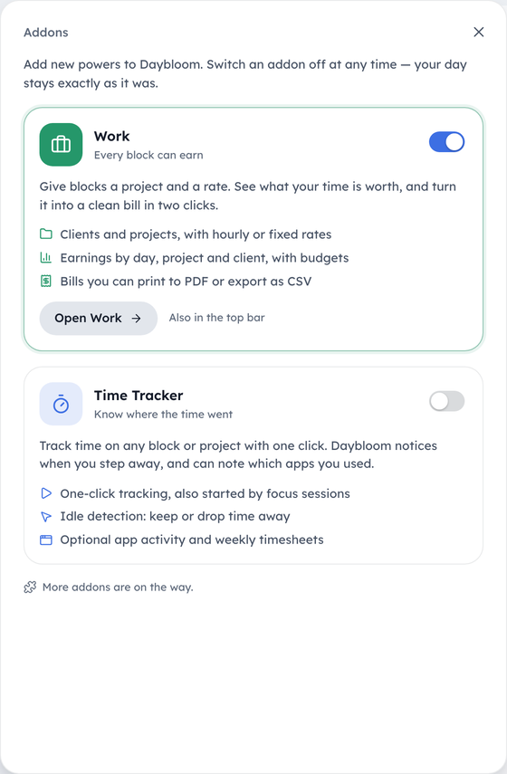

</td>
<td valign="top">

### Work: every block can earn
Give blocks a project and a rate. See what you earned this week, budgets, and the work that isn't billed yet. Make a bill and print it to PDF.

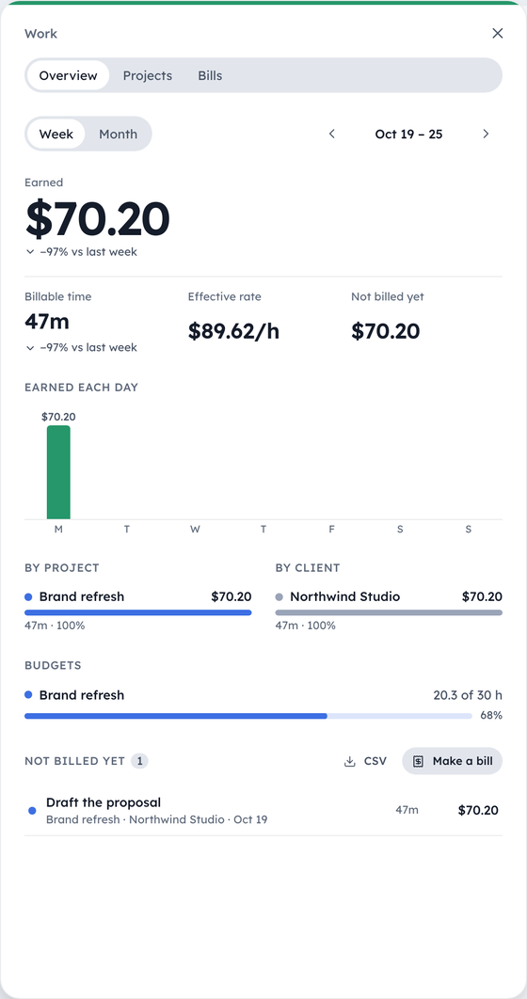

</td>
</tr>
<tr>
<td valign="top">

### Time Tracker
A live stopwatch for any block or project. Daybloom notices when you step away, and focus sessions track themselves.

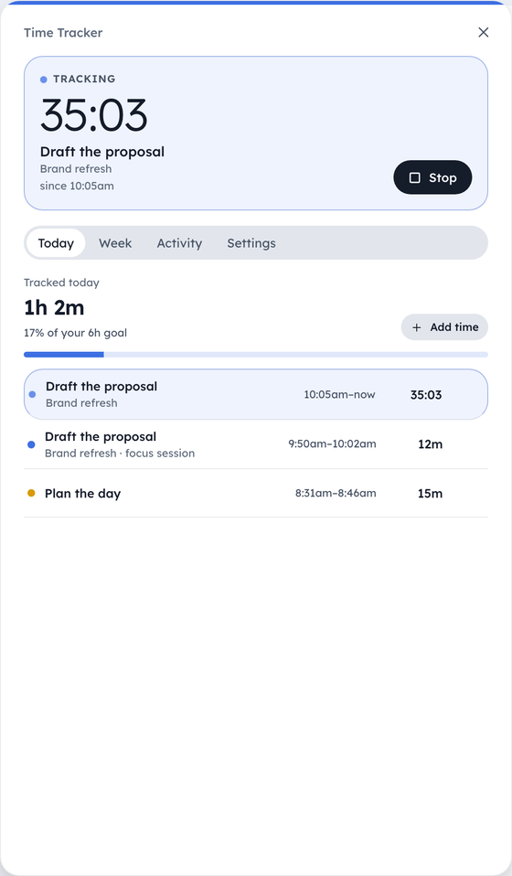

</td>
<td valign="top">

### Calendars in one place
Sign in with Google, or paste a calendar link from Google, iCloud or Outlook. Daybloom shows a preview before it adds anything.


<br><br>

### Privacy mode
Keep Daybloom out of screenshots, screen recordings and screen sharing with <kbd>⇧</kbd><kbd>⌘</kbd><kbd>P</kbd>.

</td>
</tr>
<tr>
<td valign="top">

### Waqt: salah in your day
The five salah times on your dial and in your plans, with adhan, jamaat and Jumu’ah. Gentle reminders, the Hijri date and the Qibla.

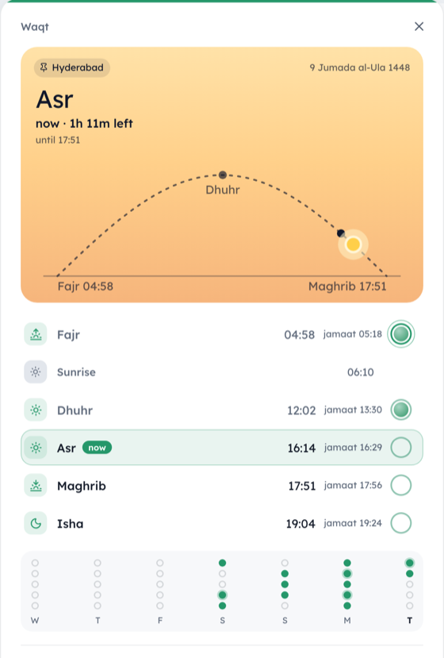

</td>
<td valign="top">

### MCP: plan with your AI apps
Claude, Codex and other AI apps can read your day, find free time and add or move blocks. Only on this computer, behind a key. Every change has an Undo.

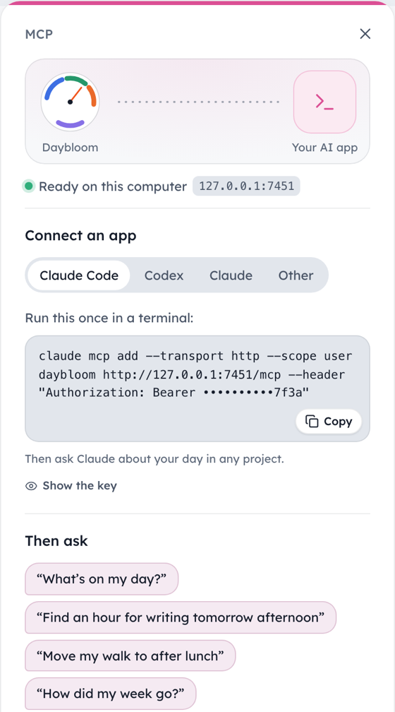

</td>
</tr>
<tr>
<td valign="top">

### Alef: a small robot friend
Alef lives in the middle of your dial. Its eyes show how it feels about your day. It keeps you company while you work, cheers when you finish, and helps you plan when you talk to it.

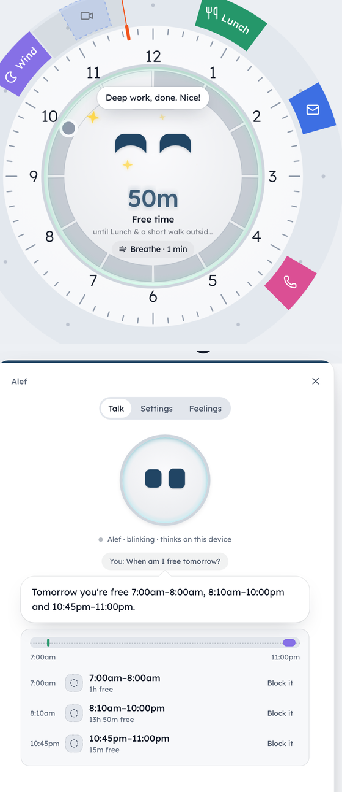

</td>
<td valign="top">

### Soft landings
After meetings, energy goes down. Daybloom keeps a few minutes free after them. When a meeting ends, it offers three small steps: a reset for your body, a little spark, and a two-minute first step into what is next.

<br>

### Retrospection
Look back over a week or a month. See the story in a few lines, what went well, your days at a glance, and what could be easier. Each pattern comes with a gentle tip and a fix that takes one click.

</td>
</tr>
<tr>
<td colspan="2" valign="top">

**More addons:** **Breadcrumbs** keeps one line about where you stopped a task, and shows it when you come back. **Make it smaller** splits a task that feels too big into small steps; the first step takes two minutes. **Reality check** learns how long your blocks really take, and offers a better length when you plan.

</td>
</tr>
<tr>
<td colspan="2" valign="top">

### Always in view
A small, transparent dial floats over your work or sits on the desktop. On macOS, the menu bar shows the countdown.

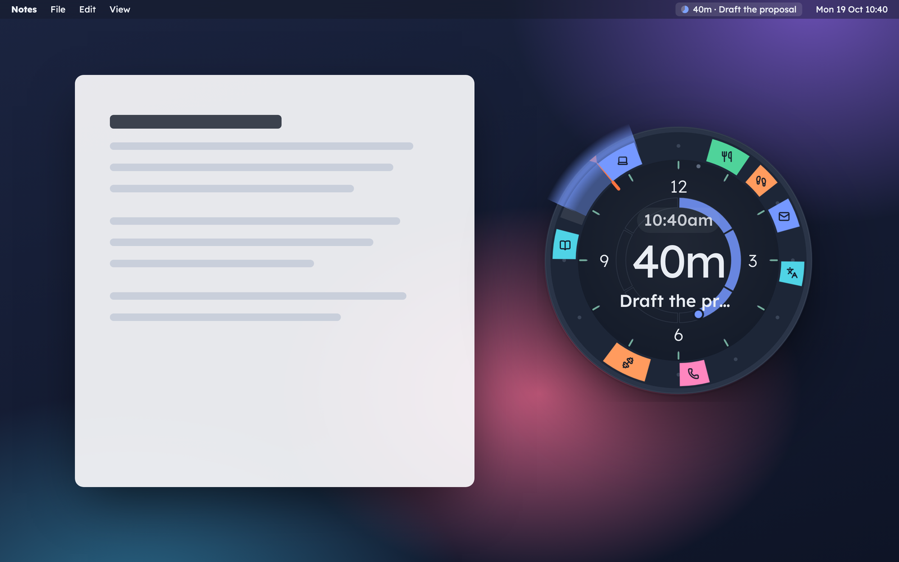

</td>
</tr>
</table>

**Also included:** voice dictation in quick add · recurring blocks · multiple Google Calendar accounts and calendar links · sync between computers through a private GitHub repo · notifications and soft sounds · a one-minute breathing guide · an evening wind-down · keyboard control · signed automatic updates.

<br>

## Install

Get the newest installers from [**Releases**](https://github.com/alshell7/daybloom/releases/latest).

### macOS

1. Download `Daybloom_<version>_universal.dmg`. It works on Apple silicon and Intel Macs.
2. Open the `.dmg` file.
3. Drag **Daybloom** into **Applications**.
4. Open Daybloom from **Applications**.
5. If macOS stops the app, open **System Settings › Privacy & Security**.
6. Scroll to **Security**. Click **Open Anyway** next to the Daybloom message.

> [!NOTE]
> Daybloom is not notarised by Apple yet. Thus macOS asks you once. Later updates install without this step.

### Windows

1. Download `Daybloom_<version>_x64-setup.exe`. The `.msi` file is an alternative for managed computers.
2. Run the installer.
3. If Microsoft Defender SmartScreen shows a warning, click **More info**.
4. Click **Run anyway**.

### Android

1. On your phone, open [**Releases**](https://github.com/alshell7/daybloom/releases/latest) and download `Daybloom_<version>_android.apk`.
2. Open the file. If Android asks, allow your browser to install apps.
3. Tap **Install**, then **Open**.
4. When Daybloom first has a reminder for you, Android asks to allow notifications. Tap **Allow**.
5. To check what reminders and alarms may do, open **Settings › Phone**. Tap **Turn on** next to any item that is off.

To add the widgets, open **Settings › Phone** and tap **Add the dial** or **Add Alef**.

> [!NOTE]
> The Android app updates like the computer apps: the **Update** chip shows a new version, and Android installs it after you tap **Install**.

### Updates

Daybloom checks for updates when it starts and every 6 hours. When an update is available, an **Update** chip shows in the top bar.

1. Click **Update**.
2. Wait while the chip fills. Daybloom downloads the update and checks its signature.
3. Daybloom restarts with the new version.

To check manually, open **Settings › App › Updates** and click **Check now**.

> [!IMPORTANT]
> Daybloom installs only updates that have a valid signature. It rejects all other files.

<br>

## Guide

The guide uses these terms:

| Term | Meaning |
|---|---|
| **Block** | One item on your day, with a start time and a length. Example: “Lunch, 12:30, 40 min”. |
| **Dial** | The clock face. Each block is an arc on its ring. |
| **Hand** | The orange line on the dial. It points to the current time. |
| **Timeline** | The list of blocks on the right side of the planner. |
| **Backlog** | The tasks that do not have a time yet. |
| **Widget** | The small dial that stays on your desktop. |

### Read the dial

- The **hand** shows the current time.
- The **centre** shows the time left in the current block. In the last 5 minutes, it counts seconds.
- The **inner ring** gets shorter as the block uses its time.
- A dotted block is a block that ended without a tick.
- A hatched block is an event from a calendar. You cannot edit it in Daybloom.

To change the dial type, click **12 h**, **24 h**, **Hour** or **Cycles** below the dial. You can also press <kbd>1</kbd>, <kbd>2</kbd>, <kbd>3</kbd> or <kbd>4</kbd>.

- **Clock style:** times show as 12-hour (2:30pm) or 24-hour (14:30), the same as your computer's clock. To change this, open **Settings › Rhythm** and select **12h** or **24h**.
- **Timeline width:** the timeline on the right uses the space that the dial does not need. To make it wider or narrower, drag its left edge. Double-click the edge to make it fit again.
- **Timeline:** a block's capsule is empty before it starts, fills while it runs and is full when its time has passed. A full capsule with a dashed edge ended without a tick. The line through the capsules is solid up to now. Free time shows as an empty, dashed capsule; a longer free time is taller.
- **Filter the timeline:** click the filter button next to **Anytime** (or **Timeline**). Select what to show: your blocks, calendars, addons such as Waqt, finished blocks, free time and kinds of block. The dial does not change.

### Add a block

**With words:**

1. Click the **Quick add** field at the top of the timeline.
2. Type the block in plain words.
3. Look at the preview. Make sure that the time and the length are correct.
4. Press <kbd>Enter</kbd>.

| You type | Daybloom adds |
|---|---|
| `gym 5pm 45m` | Gym, today at 17:00, 45 minutes |
| `lunch 12:30 for 45 mins` | Lunch, today at 12:30, 45 minutes |
| `meds every day 8am` | Meds, every day at 08:00 |
| `standup weekdays 9:30 15m` | Standup, Monday to Friday at 09:30, 15 minutes |
| `team sync every mon and thu 2-3pm` | Team sync, every Monday and Thursday, 14:00 to 15:00 |
| `dentist on fri at 3` | Dentist, next Friday at 15:00 |
| `yoga every other day 7am 30m` | Yoga, every 2 days at 07:00, 30 minutes |
| `water plants anytime` | Water plants, today, without a fixed time |
| `return parcel later` | Return parcel, in the backlog |

**With one key:** press <kbd>N</kbd>. Daybloom adds a 30-minute block in the next free time and opens it for editing.

**On the dial:**

1. Put the pointer on the ring at the start time.
2. Push and hold the mouse button.
3. Drag around the ring to the end time. The dial clicks at each 5-minute step.
4. Release the mouse button.

### Change a block

- **Move:** drag the block up or down in the timeline, or drag its arc on the dial.
- **Change the length:** drag the bottom edge of the block in the timeline, or drag the knob at the end of its arc.
- **Fine adjustment:** put the pointer on an arc and turn the scroll wheel.
- **Edit the details:** click the block. You can change the title, icon, colour, repeat rule, alerts, steps and notes.
- **Repeating blocks:** when you edit a repeating block, select **Every time** or **Just this day**.
- **Remove:** select the block and press <kbd>Delete</kbd>.
- **Pick a day or a time:** click the day or the time. Type it (“fri”, “30 oct”, “+3”, “930”, “2:30pm”, “noon”), click a day in the month, or drag the hand on the small dial. The dial shows your other blocks that day, so free time is easy to see. **Next free** puts the block in the first free time that fits. Without opening it, the arrow keys move the day or the time.

### Finish a block

- Click the circle at the right of the block in the timeline.
- Or select the block and press <kbd>Space</kbd>.

The block fills, gets a line through its title and lights up on the ring.

When a block ends without a tick, Daybloom asks “Did you finish?”. Select one of these:

| Option | Result |
|---|---|
| **Done** | The block is finished. |
| **+15m** | The block gets 15 more minutes. |
| **Later** | The block goes to the backlog. |
| **Let go** | The block stays as it is. Daybloom does not ask again. |

### Use the backlog

**Add a task quickly:**

- Click the **Backlog** button (tray) in the top bar. Type the task and push <kbd>Enter</kbd>. The card stays open for the next task.
- From anywhere: open the Daybloom menu in the menu bar (macOS) or the notification area (Windows) and select **Add to Backlog…**. A small card opens over your work. Type, push <kbd>Enter</kbd>, and it closes. You do not have to open the planner.
- Write durations, due dates and priority in the text, for example “Renew passport by fri 20m !”.

**Sort the backlog:**

1. Push <kbd>B</kbd>, or click **Open the backlog** in the capture card.
2. Type in **Brain dump**. Put one task on each line.
3. Sort the tasks into **Inbox**, **Next** and **Someday**.
4. To schedule a task, drag it onto the dial. You can also click **Plan my day**.

Use **Must**, **Should** and **Could** to set the priority. Add a due date to make a task show earlier.

### Ask Daybloom

1. Press <kbd>⌘</kbd> <kbd>K</kbd> on macOS or <kbd>Ctrl</kbd> <kbd>K</kbd> on Windows.
2. Type a request.
3. Press <kbd>Enter</kbd>.
4. Use the buttons on the cards to do the action.

Examples:

- `what's now?`
- `plan my day`
- `add gym at 5pm for 45 minutes`
- `move lunch to 2pm`
- `start a 25 minute focus`
- `show backlog`
- `how did my week go?`

You can also speak your request. See [Talk to Daybloom](#talk-to-daybloom).

The assistant works in **basic mode** without a download. For better understanding of requests, download **Needle**:

1. Open **Settings › AI**.
2. Under **On this device**, click **Download** next to Needle (35 MB, one time).

Needle is a small on-device model by [Cactus Compute](https://cactuscompute.com/needle) (Apache-2.0). Daybloom checks the download with SHA-256. After the download, the assistant works offline. It does not send your requests to a server.

To let an AI service answer instead, set it up in **Settings › AI**, then select it for **Ask Daybloom** under **Who uses what**. It can read and change your day; one **Undo** takes back all its changes. If the service does not answer, Daybloom answers on this device.

### Talk to Daybloom

**Talk once (push to talk):**

1. Push and hold <kbd>V</kbd>.
2. Say what you want. Example: “Add gym at 5 for 45 minutes”.
3. Release <kbd>V</kbd>.

**Talk hands-free:**

1. Push <kbd>V</kbd> one time and release it.
2. Speak. Daybloom stops listening when you pause.

The voice capsule shows your words while you speak. When you stop, the assistant does the action and shows its card. Push <kbd>Enter</kbd> to send immediately, or <kbd>Esc</kbd> to cancel.

You can also use the microphone in **Quick add** or in **Ask Daybloom**. Push and hold it to talk, and release it to finish. Or click it one time to talk hands-free. In a text field, push and hold <kbd>⌥</kbd> <kbd>V</kbd> (<kbd>Alt</kbd> <kbd>V</kbd> on Windows). In Quick add, your words show in the field while you speak. Look at the preview, then push <kbd>Enter</kbd>.

If your computer has no microphone, the voice capsule tells you. Connect a microphone (for example a headset) and try again.

The first time, Daybloom asks to download **Whistle** (17 MB, one time). Whistle is a speech model by [Cactus Compute](https://cactuscompute.com/blog/whistle) (Apache-2.0). It runs on your computer. Daybloom checks the download with SHA-256.

> [!NOTE]
> The microphone is on only while the capsule shows “Listening”. The first time, macOS or Windows asks for permission to use the microphone.

To change the language, open **Settings › AI**. Commands are understood in English.

### See your week

Click the **Your week** button in the top bar, or press <kbd>I</kbd>.

- **This week** shows seven small dials and what you finished.
- **Last 4 weeks** shows longer patterns.
- **Rhythm** counts the days on which you finished something.
- Each 7 counted days give you one rest day (maximum 2). A rest day covers one missed day, so the rhythm continues.
- Repeating blocks show how many times in a row you did them.

### Get gentle support

Open **Settings › Rhythm › Gentle support**. You can turn on or turn off each item.

| Setting | What it does |
|---|---|
| Ask “did you finish?” when a block ends | Shows the check-in card. |
| Speak up when a block runs into the next | Tells you when the current block overlaps the next block. |
| Suggest backlog items that fit free time | Shows a backlog task that fits a free gap. |
| Time anchors | Gives a soft tick each hour or each 30 minutes. |
| Offer a wind-down at | In the evening, shows what you did and moves open blocks to tomorrow. |

Open **Settings › Rhythm › Transitions** to set the heads-up before a block ends (2, 5 or 10 minutes), notifications and sounds.

In free time, click **Breathe · 1 min** in the centre of the dial for a one-minute breathing guide. A soft orb of light fills while you breathe in (4 seconds), stays full while you hold (4 seconds), and empties slowly while you breathe out (6 seconds). Then you rest for 2 seconds. This repeats four times. The words in the centre tell you what to do.

### Start a focus session

1. Push <kbd>F</kbd>, or click the **Focus** button in the top bar.
2. Under **Focus on**, select the current block, the next block, a backlog task or **Just focus**.
3. Under **For how long**, drag the knob around the dial. One lap is 1 hour. Continue past 12 for a second hour.
4. Or click a chip: **Rest of block**, **Until** the next block, a saved length, or **Just 2 min**.
5. Under **Rhythm**, select **One stretch** or **Cycles with breaks**. For cycles, set the number of rounds.
6. Click **Start focus**, or push <kbd>Enter</kbd>.

Focus mode then shows only the session, the steps of the task and the next block. When the session ends, Daybloom asks if the task is done.

- To pause, skip a round or stop, use the buttons in the centre of the dial.
- To go back to the planner, push <kbd>Esc</kbd> or click the shrink button. The session continues.
- To see the session again, click its timer in the top bar, push <kbd>F</kbd>, or double-click the desktop widget.
- A backlog task that you focus on becomes a block on today's dial.

### Use screen cues

Screen cues are optional signals on your desktop. They help you keep the time in view, also when Daybloom is behind other windows. They do not take clicks or the keyboard.

1. Open **Settings › Screen › Screen cues**.
2. Under **Show them**, select **In focus sessions** or **For every block**.
3. Turn on the cues that you want:

| Cue | What it does | Options |
|---|---|---|
| **Edge glow** | The edge of the screen breathes in the colour of the task. It breathes faster in the last 5 minutes and in the last minute. | Soft, Medium, Strong |
| **Time bar** | A thin bar drains as the time goes. The time left shows at its tip. | Top, bottom, left or right edge. Thin or Bold. |
| **HUD** | A small pill with a ring, the task name and the time left. | Any corner |
| **Colour** | All cues use the colour of the task, or one colour that you select. | Task colour, 7 calm colours, or any colour |

When you turn on a cue, Daybloom shows a preview for a few seconds. You can also turn cues on and off in the focus launcher. Use the HUD, the widget, or both.

### Use privacy mode

Privacy mode keeps Daybloom's windows out of screenshots, screen recordings and screen sharing. Use it when you share your screen.

1. Push <kbd>⇧</kbd> <kbd>⌘</kbd> <kbd>P</kbd> (<kbd>Ctrl</kbd> <kbd>Shift</kbd> <kbd>P</kbd> on Windows). You can also open the **More** menu (…) in the top bar, or the Daybloom icon in the menu bar or notification area, and select **Privacy mode**.
2. A **Private** pill shows in the top bar. Click it to turn privacy mode off.
3. Optional: open **Settings › Screen › Privacy** and turn on **Hide block names**. The widget, the HUD and the menu bar then show the category (for example “Focus”) instead of the block name.

> [!NOTE]
> Windows leaves protected windows out of captures. On macOS, screenshots leave them out, but some screen recorders can still capture them. Use **Hide block names** as a second layer when you share your screen on a Mac.

### Use addons

1. Click the **Addons** button (puzzle) in the top bar. You can also open **Settings › Connect › Addons**.
2. Turn on an addon with its switch.
3. The addon adds its own button to the top bar and its fields to the block editor.

Addon data is kept separately from your blocks. When you turn an addon off, your day does not change, and the addon keeps its data for later.

### Bill your time with Work

**Do these steps one time:**

1. Turn on **Work** in the Addons gallery.
2. Open **Work › Projects** and click **New project**.
3. Enter a name, and select or add a client.
4. Set a rate: **Per hour**, **Per block** (a fixed amount), or **Client rate**. Optional: set a budget in hours or money.
5. Open **Work › Bills › Your details on bills** and enter your name, email and address.

**Every day:**

1. Open a block and select its project under **Work**. The block editor shows what the block earns.
2. Finish the block. Daybloom adds it to your earnings. If you track time on the block, Daybloom bills the tracked time.
3. Open **Work › Overview** to see the week or the month: earnings, billable time, effective rate, budgets and the work that is not billed yet.

**Make a bill:**

1. Open **Work › Bills** and click **New bill**.
2. Select the client, the period and how to group the lines (by block, by project or by day).
3. Look at the preview, then click **Save bill**.
4. Click **Print / PDF**. The bill opens in your browser. Print it and select **Save as PDF**. Click **CSV** for a spreadsheet.
5. Click **Mark sent** and **Mark paid** to keep the status. Work that is on a bill never goes on a second bill.

Exports go to your **Downloads** folder.

### Track your time

1. Turn on **Time Tracker** in the Addons gallery.
2. Click the stopwatch button in the top bar.
3. Select what you work on (the current block, a later block or a project), then click **Start**. You can also click **Track this block** in the block editor.
4. The time runs in a pill in the top bar. Click the square to stop.

- **Focus sessions** track themselves. Turn this off in **Time Tracker › Settings**.
- **Time away:** when you do not use the computer for 5 minutes (you can change this), Daybloom asks what to do with that time: **Keep it**, **Drop it**, or **Drop it and stop**.
- **Edit entries:** in **Today**, click the times of an entry to change them. Click **Add time** to add time that you forgot to track.
- **Week:** see the hours of each day and the totals by block. Click **Export timesheet (CSV)**.
- **Activity (optional):** turn on **Note the apps I use while tracking**. Daybloom notes the name of the app in front every 30 seconds, only while the stopwatch runs. On Windows you can also note window titles. This data stays on your computer.

### Leave breadcrumbs

1. Turn on **Breadcrumbs** in the Addons gallery.
2. When you leave focus mode or a focus session ends, Daybloom asks: “Where did you leave off?” Type one line, or skip it.
3. When you come back to the task, your last note shows in focus mode and in the block editor.

- **Park a thought:** during focus, write a stray thought in **Park a thought**. It waits in the **Breadcrumbs** panel. Send it to the backlog, or let it go.
- **When to ask:** change this in the **Breadcrumbs** panel.

### Make a task smaller

1. Turn on **Make it smaller** in the Addons gallery.
2. Click **Too big?** on a task: in the block editor, in the backlog or in focus mode.
3. Daybloom shows a few small steps. Change, remove or add steps, then click **Keep the steps**.
4. Optional: click **Start the first step** for a 2-minute focus session.

With an AI service selected for **Make it smaller** in **Settings › AI**, the steps fit your task: its notes, the steps it already has, the time before your next block, and how long tasks like it really take you. Each step says when it is done, and a tip comes with them. To split a step again, click **Make this step smaller** (the layers button). The built-in ideas show first, and the service's steps replace them when they arrive.

### Plan with real times

1. Turn on **Reality check** in the Addons gallery.
2. Finish blocks as usual. Daybloom learns how long they really take, from ticks, focus sessions and tracked time.
3. When you set the length of a block, Daybloom can show “usually ~45m”. Click it to use that length.
4. Open the **Reality check** panel to see planned and real time side by side, by task and by kind of task.

Reality check never changes your plans by itself.

### Keep salah times with Waqt

1. Turn on **Waqt** in the Addons gallery, then click the moon in the top bar.
2. Search for your city, or click **Use my location**. Under **Place and method**, select the calculation method and the Asr time (**Standard** or **Hanafi**).
3. Optional: under **Jamaat and Jumu’ah**, set the jamaat time of your mosque for each prayer, and Jumu’ah on Fridays.

- **On the dial:** each prayer’s time shows on the dial. Prayer blocks make room in your plans, so other blocks do not take that time.
- **Reminders:** Daybloom reminds you before the adhan, at the adhan and before jamaat. Change the times or turn the sound off under **Reminders**.
- **Mark a prayer:** click the circle next to a prayer. One click: prayed. Two clicks: prayed in jamaat.
- **Your mosque’s times:** if your mosque gives fixed times, enter them under **Your mosque’s times**. Daybloom uses them in place of the calculated times.

### Connect AI apps with MCP

MCP (Model Context Protocol) lets AI apps use tools. With this addon, an AI app can read your day and help you plan it.

1. Turn on **MCP** in the Addons gallery, then click the plug in the top bar.
2. Under **Connect an app**, select your app: **Claude Code**, **Codex**, **Claude** or **Other**.
3. Click **Copy** and do the step that the panel shows: run the command in a terminal, or paste the text in the app's settings.
4. Ask your AI app, for example: “What's on my day?” or “Find an hour for writing tomorrow afternoon.”

What an AI app can do:

| Read | Change (you can turn this off) |
|---|---|
| A day, with free time and what is happening now | Add a block, with steps and repeats |
| Blocks over a range of days | Move, resize or rename a block |
| The backlog | Finish or remove a block |
| Settings (never keys or passwords) | Add to the backlog, and plan a backlog task |
| Insights for 7 or 28 days | Change waking hours, theme, sounds and focus length |
| Salah times, when Waqt is on | |

- **Undo:** each change shows a message in Daybloom with **Undo**. The **Activity** list shows what each app did.
- **Read only:** turn off **Let apps change my plans**. Apps can then only read.
- **Safety:** Daybloom answers only on this computer (127.0.0.1), and only to apps that have the key. Web pages cannot connect. Click **Make a new key** to stop old setups.
- **Daybloom must run.** The AI app talks to the open Daybloom app. Codex and Claude start a small relay (`daybloom --mcp`) that finds the key by itself.

### Meet Alef

1. Turn on **Alef** in the Addons gallery. Alef's face shows in the middle of the dial, in focus mode and on the desktop widget.
2. Click the robot in the top bar, or double-click Alef's face, to open the Alef panel.

Alef shows how it feels with its eyes, a soft light around its screen, small movements of the dial, and sounds. It reacts to your day: it is glad when you finish a block, it asks kindly when a block ends without a tick, and it gets sleepy late at night. It never blames you.

**Touch Alef:**

| Do this on Alef's face | Alef |
|---|---|
| Click | Says hello. Many clicks in a row make it grumpy, for a moment. |
| Move the pointer slowly from side to side | Purrs, like a pet |
| Move the pointer quickly from side to side | Giggles |
| Press and hold | Squeezes its eyes shut, then jumps back |
| Click when it sleeps | Wakes up |

On the desktop widget, you can pet Alef and click it too.

**On its own,** Alef says hello when you come back, asks you to stretch after a long time at the screen, cheers when a focus session is half done, and dances when every block of the day is done. Under **How much Alef talks**, select **Quiet**, **Now and then** or **Chatty**.

**A helping hand:** at the right moments, Alef offers one small next step under its words. Click it to do it:

| When | Alef offers |
|---|---|
| A block starts | **Start with 2 minutes** (and **Make it smaller** for a long block) |
| A block ends without a tick | **Done**, **10 more min** or **Move it** |
| You sit in a block for a while and nothing starts | **Start with 2 minutes**, side by side |
| Some blocks of the day did not happen | **Just one thing** or **Fresh start tomorrow** |
| You have free time and a backlog task fits | **Do it** |

Alef also reacts when you add a block, drag one or change the look, and it looks at the block that you select.

**Talk to Alef:** in the **Talk** tab, type or click the microphone. Ask about your day, or ask it to plan: “When am I free tomorrow?”, “Add reading in my free time”, “I'm stuck”. Your last conversation stays when you open Alef again.

- **On this device** (the default): Alef uses Daybloom's own assistant. Nothing leaves your computer.
- **With an AI service:** set up the service one time in **Settings › AI** (see [Set up AI](#set-up-ai)). Then, under **Alef's brain**, select it. With **Alef may change my plans** on, it can add, move or finish blocks. Each change shows a message with **Undo**. With **Speaks up in its own words** on, Alef writes its own hellos, check-ins and cheers, a few times a day.
- While the AI service works, Alef shows what it does (for example, “Finding free time…”).
- If the AI service does not answer, Alef answers on this device and tells you why.

**Voice:** under **Voice**, select **Chirps** (small robot sounds), **On-device voice** (a small spoken voice), **System voice**, **Off**, or a voice from an AI service that you set up. The on-device voice needs a download of about 30 MB, one time. Daybloom checks the download with SHA-256, and the voice works on your computer. Alef uses the sound switch and volume from Settings.

**Look:** under **Screen**, select **Dial colours** (Alef's screen uses the colours of your dial) or **OLED black**. Select the colour of the eyes and of the mood light. **Feelings** shows all 32 feelings and Alef's tricks.

### Set up AI

Set up an AI service one time. Then select which part of Daybloom uses it.

1. Open **Settings › AI**.
2. Under **Services**, click a service: OpenAI, Anthropic, Gemini, OpenRouter, Cloudflare or **Custom** (any address that works like OpenAI's).
3. Enter your key. Daybloom keeps it in your system's keychain.
4. Select a model. Click the refresh button to see all the models that you can use.
5. Click **Say hello** to test the service.
6. Read what Daybloom sends to the service, then click **I agree**. Daybloom sends nothing before you agree.
7. Under **Who uses what**, select what each part uses:

| Part | Can use |
|---|---|
| Alef | A service to think, and a voice to speak |
| Getting started | Ready-made first steps, or a service |
| Ask Daybloom | Needle on this device, or a service |
| Make it smaller | Built-in ideas, or a service |
| Reality check | Your own numbers, or a service |
| Voice input | Whistle on this device, or a service that listens (such as OpenAI) |

Under **On this device**, download or remove Needle, Whistle and Alef's voice. They work without the internet.

### Get help to start

When one of your blocks begins, a card offers one tiny first step for it, such as “open the report and write one messy line”. Daybloom also adds the step as the block's first step.

1. Click **Start · 2 min** to do just that step as a short focus.
2. To get a different step, click **Another idea**. To close the card, click **Not now**.

When the short focus ends, Daybloom ticks the step. To get steps that fit your exact task, select an AI service for **Getting started** in **Settings › AI**. To turn the help off, open **Settings › Rhythm › Gentle support**.

### Set an alarm

1. Open a block that has a time.
2. Turn on **Ring as an alarm**. To use a different tone for this block, select it.

You can also type it in quick add: “alarm at 7am” or “wake me at 6:30”.

When the block starts, Daybloom comes to the front and rings. Click **Stop**, **Snooze** or **Start now**. Press <kbd>Space</kbd> or <kbd>Esc</kbd> to stop, or <kbd>S</kbd> to snooze. The alarm stops by itself after a few minutes.

To change the tone, the volume, the snooze time and the gentle start, open **Settings › Rhythm › Alarm**. Alarms ring also when **Sounds** is off.

### Compare time zones

1. Click the time-zone chip in the top bar.
2. Click the pin next to a city. You can pin two cities.

The dial shows each city's day and night as a thin ring, with its time. To change the cities, or to hide the rings, open **Settings › Rhythm › World clock**.

### See the timeline as a board or a Gantt chart

1. Turn on **Timeline views** in the Addons gallery.
2. At the top of the timeline, select **List**, **Board** or **Gantt**.

**Board:** drag a card between **Later**, **Today**, **Now** and **Done**. A card from **Later** goes to the first free time. Select **Week** to drag cards between days. Keys: arrows move between cards, <kbd>Shift</kbd>+<kbd>←</kbd>/<kbd>→</kbd> moves a card to the next column, <kbd>Space</kbd> ticks it.

**Gantt:** drag a bar to move it, drag its ends to change its length, or drag on an empty row to add a block. Select **Day**, **3 days** or **Week**. To zoom, pinch the trackpad or hold <kbd>Ctrl</kbd> and scroll.

Calendar events and salah show in both views, but you cannot move them.

### See what you've done

Click **N of N done** at the top of the timeline, or open **Your week** (<kbd>I</kbd>) and select **Done**. Every block, backlog task, calendar event and salah that you finished shows by day. Type to search, or select **Tasks**, **Calendar**, **Salah** or a category. To undo a tick, click the check at the end of the row.

### See the month

1. Click the date in the top bar, click the calendar button next to the week, or press <kbd>M</kbd>.
2. Click a day to go to it. Or type a day, for example “fri”, “next week” or “12 nov”, and press <kbd>Enter</kbd>.

Each day shows a small ring of its blocks. Use the arrow keys to move by day, and <kbd>Page Up</kbd>/<kbd>Page Down</kbd> to move by month. To look at other weeks without leaving your day, click ‹ › in the week strip or swipe it sideways.

### Start fresh

**Clear the sample day:** at the end of the getting-started card, click **Start with a clean dial**. Or open **Settings › App › Your data** and click **Clear sample day**. Sample blocks that you renamed stay.

**Reset Daybloom:**

1. Open **Settings › App › Your data** and click **Reset Daybloom…**.
2. Select what to clear: blocks and backlog, progress, settings, addons and their data, AI services and keys, calendars, GitHub sync, downloaded models — or **Everything**.
3. Optional: click **Save a copy** to keep a file of your blocks and settings.
4. Press and hold **Hold to reset** until it fills.

Daybloom clears what you selected on this computer and starts again. Your calendars and your GitHub repository stay as they are.

### Choose the top bar buttons

Open **Settings › Screen › Top bar** and turn each button on or off. Hidden buttons stay in the **More** menu (⋯). When the window is narrow, buttons that do not fit also move into **More**, and they come back when the window is wide again.

### Restore from the Trash

When you delete a block or a backlog task, it goes to the Trash for 30 days.

1. Open the backlog and click **Trash**, or open **Settings › App › Your data › Trash**.
2. Click **Restore** next to the item. The block goes back to its day.

To delete an item forever, click **✕** next to it, then click **Forever?**. After 30 days, Daybloom deletes items in the Trash by itself.

### Plan with real times, with AI

1. Turn on **Reality check** in the Addons gallery.
2. In **Settings › AI**, under **Who uses what**, select an AI service for **Reality check**.

- **In the block editor:** when you set a length, Daybloom suggests a realistic one from your own record, with the reason and a tip. Click **Use** to take it.
- **In Reality check:** **Practical tips** looks at your record and at what is left today. Some tips have a button: **Make it 50m** gives a repeating task its real length, and **Move to tomorrow** moves one block so today fits. Each change has an **Undo**.

Daybloom sends the service the block's title, notes and steps, and the planned and real lengths of your finished blocks.

### Land softly after meetings

1. Turn on **Soft landings** in the Addons gallery, then click the leaf in the top bar.
2. Under **Keep time to land**, set how many minutes to keep free after meetings and long focus.
3. Under **When to offer a landing**, select when the card shows: when a meeting ends, after 90 minutes or more of focus, or both.

- **When a meeting ends:** a card offers three small steps. Click one to start a short timer, or click **Not now**.
- **In the timeline:** when two meetings or long blocks are back to back, the timeline shows it. Click **Make room** to move the next block a few minutes later. You can undo it.
- **When you plan:** Daybloom keeps the landing time free when it suggests a time.

### Look back with Retrospection

1. Turn on **Retrospection** in the Addons gallery, then click the rising line in the top bar.
2. Select **This week**, **Last week** or **30 days**.

- **Bright spots:** your best days, your focus time and your strongest hours.
- **What could be easier:** patterns that make your days harder, each with a tip and a fix that takes one click.
- **Keep, change, try:** write three short lines for the week. Daybloom saves them.

### Use the desktop widget

1. Press <kbd>W</kbd>, or click the **Desktop widget** button in the top bar.
2. Drag the widget to a position on your screen.
3. Double-click the widget to open the planner.

Open **Settings › Screen › Desktop widget** to change these options:

- **Position:** **Float on top** keeps the widget above other windows. **On desktop** keeps it below other windows.
- **Dial:** the dial type of the widget.
- **Countdown in the menu bar** (macOS only).
- **Open at login.**

When you close the planner, Daybloom stays in the menu bar (macOS) or in the notification area (Windows).

### Change the theme

- To switch between light and dark, click the sun or moon button in the top bar.
- To select a theme, open **Settings › Look › Theme**.

| Light | Dark |
|---|---|
| Fog, Linen, Mist, Sage | Midnight, Black (true black), Graphite, Forest, Plum, Cocoa |

Open **Settings › Look › Comfort** to set **Calm** motion or the **Hyperlegible** reading font.

### Change the time zone

1. Click the globe chip next to the date in the top bar.
2. Search for a city.
3. Select the city.

Repeating blocks keep their clock times. Calendar events keep their real moments.

### Connect calendars

Open the **More** menu (…) in the top bar and select **Calendars**. You can also open **Settings › Connect › Calendars**.

**Add a calendar link (Google, iCloud, Outlook and others):**

1. Click **Calendar link**.
2. Paste the link. Daybloom checks it and shows a preview: the name, the next event and the number of events in the next 2 weeks.
3. Change the name if you want, then click **Add**.

**Find the link for a Google calendar:**

1. Open Google Calendar on the web.
2. Open **Settings**, then select the calendar under **Settings for my calendars**.
3. Select **Integrate calendar**.
4. Copy **Secret address in iCal format**. Use the secret address: the public address works only if the calendar is public.

> [!WARNING]
> A secret address gives read access to your calendar. Do not share it. Daybloom keeps calendar links in the system keychain, not in its files.

**Sign in with Google:** click **Google account**. You can add more than one account, for example work and personal. Daybloom needs a Google OAuth client of the type “Desktop app”. See [docs/calendar.md](docs/calendar.md).

Calendar events are read-only. In the timeline they have a striped, outlined capsule and a chip with the calendar name. Your own blocks have a solid capsule. When the same event is in two accounts, Daybloom shows it one time.

**Change a calendar** (in the Calendars panel):

- **Name:** click the account name, or the pencil next to a calendar.
- **Colour:** click the colour dot next to a calendar. Select a category colour, or **Auto** for the calendar's own colour.
- **Show or hide:** use the switch next to the calendar.
- **Events to include:** open the list and clear the box next to an event. Daybloom then hides that event and all its repeats from the dial, the timeline and tracking. All events are included at first.
- **Checks for changes:** select how often Daybloom gets new events: 5 or 10 minutes, 30 minutes, 1 hour, 6 hours, or **Manual** (only when you click **Sync now**). Google refreshes its own calendar links only every few hours.

### Sync

Sync keeps your blocks, settings and badges the same on all your devices. It also syncs the Trash, what you did with calendar events, your AI setup, and the data of these addons: Work, Time Tracker, Breadcrumbs, Reality check, Waqt, Alef, Retrospection and Soft landings. There is no Daybloom server. Use one of these services, or both:

- **GitHub:** small files in a private repo that you own.
- **Cloudflare D1:** a database in your own Cloudflare account. It is always encrypted.

**The master password.** Encrypted sync seals all your files before they leave your device. Only your master password, or your recovery key, can open them. One master password serves both services.

- When you set the password, Daybloom shows your **recovery key** one time. Save it in a password manager or on paper.
- Daybloom cannot reset the password. If you lose the password and the recovery key, the copy in the cloud is lost. The data on each device stays.
- With encryption on, your calendar subscriptions, their links and your AI keys also sync. A new device then needs only your password.
- On a phone, you can unlock with your fingerprint. Open **Settings › Connect › Sync** and turn on **Unlock with fingerprint on this phone**.

#### GitHub

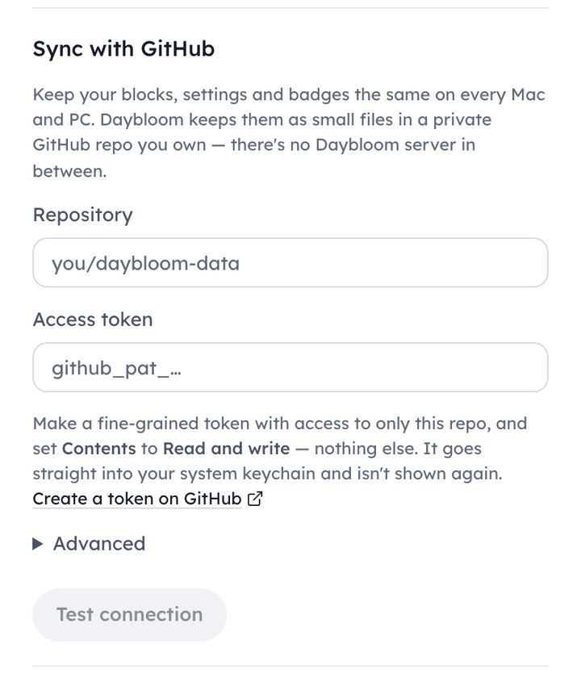

**Do these steps one time:**

1. On GitHub, create a **private** repository. Example: `daybloom-data`.
2. Create a [fine-grained personal access token](https://github.com/settings/personal-access-tokens/new).
3. Give the token access to this repository only.
4. Set **Contents** to **Read and write**. Do not give other permissions.

**Do these steps on each computer:**

1. Open **Settings › Connect › Sync** and go to **GitHub**.
2. Enter the repository as `owner/name`.
3. Paste the token.
4. Click **Test connection**.
5. If the repository already has data, select **Use the repo's** or **Combine both**.
6. Click **Start syncing**.

Daybloom syncs a short time after each change, and every 5 minutes. The token stays in the system keychain. Settings that apply to one computer only, for example the volume and the widget position, do not sync.

To encrypt the repo, turn on **Encrypt with your master password**. Daybloom moves the files, sealed, into a `vault` folder and removes the plain files. Update Daybloom on your other devices first. Git history can still have the old plain files. For a clean start, use a new repository.

<br clear="right">

> [!WARNING]
> Use a private repository. In a public repository without encryption, everybody can read your tasks.

#### Cloudflare D1

**Do these steps one time:**

1. On the Cloudflare dashboard, copy your **Account ID**. It is in the column on the right of your account's home page.
2. Open **My Profile › API Tokens** and create a custom token.
3. Give the token one permission: **Account › D1 › Edit**, for this account only.

**Do these steps on each device:**

1. Open **Settings › Connect › Sync** and go to **Cloudflare D1**.
2. Enter the Account ID and paste the token. Tap **Connect**.
3. Select **Create “daybloom-sync”**, or select a database that you already have. Daybloom uses its own table.
4. On the first device, set your master password and save the recovery key. On other devices, enter the same password.
5. If the database already has data, select **Use the database's** or **Combine both**.
6. Click **Start syncing**.

To pause, or to disconnect, Daybloom asks for your master password. When you disconnect, you can also erase Daybloom's data from the database.

### Find a setting

Push <kbd>,</kbd> or click the **Settings** button in the top bar. Settings has six tabs:

| Tab | What it has |
|---|---|
| **Look** | Theme, dial and reading comfort |
| **Rhythm** | Your waking day, alerts and gentle support |
| **Screen** | Screen cues, the desktop widget and privacy (on a phone: **Phone**, with reminders, alarms and widgets) |
| **Voice** | The assistant and speech |
| **Connect** | Calendars, sync and addons |
| **App** | Updates, your data and keys |

To find a setting fast, type a word in **Find a setting**, for example “sound” or “widget”.

### Keyboard shortcuts

| Key | Action |
|---|---|
| <kbd>N</kbd> | New block in the next free time |
| <kbd>←</kbd> <kbd>→</kbd> | Previous day, next day |
| <kbd>T</kbd> | Today |
| <kbd>1</kbd> – <kbd>4</kbd> | Dial type: 12 h, 24 h, Hour, Cycles |
| <kbd>Space</kbd> | Finish the selected block |
| <kbd>Delete</kbd> | Remove the selected block |
| <kbd>B</kbd> | Backlog |
| <kbd>I</kbd> | Your week |
| <kbd>F</kbd> | Start a focus session (or show the running session) |
| <kbd>V</kbd> | Hold to talk, or tap to talk hands-free |
| <kbd>⌥</kbd>/<kbd>Alt</kbd> <kbd>V</kbd> | Hold to talk while you type in a field |
| <kbd>W</kbd> | Desktop widget |
| <kbd>⌘</kbd>/<kbd>Ctrl</kbd> <kbd>K</kbd> | Ask Daybloom |
| <kbd>⇧</kbd><kbd>⌘</kbd>/<kbd>Ctrl</kbd> <kbd>P</kbd> | Privacy mode on or off |
| <kbd>,</kbd> | Settings |
| <kbd>Esc</kbd> | Close the panel, cancel listening, or clear the selection |

<br>

## Your data

- Daybloom keeps all data on your device:
  - macOS: `~/Library/Application Support/app.daybloom.desktop/state/`
  - Windows: `%APPDATA%\app.daybloom.desktop\state\`
  - Android: in the app's private storage.
- Tokens, calendar sign-ins and calendar links stay in the system keychain (macOS Keychain, Windows Credential Manager, or the Android Keystore).
- With encrypted sync, GitHub or Cloudflare keeps only sealed files. Your master password never leaves your device.
- Work, Time Tracker, Breadcrumbs, Reality check and Waqt data stay on your computer, and sync with GitHub when you turn sync on. App activity tracking is a setting for each computer and never syncs.
- When sync is on, your Waqt place goes to your GitHub repo with the other Waqt settings.
- MCP data (the key and the **Activity** list) stays on this computer. It does not sync.
- The MCP addon answers only on this computer (127.0.0.1) and only to apps that have its key. An AI app gets your plans only when it uses a tool, and each use shows in the **Activity** list.
- Voice stays on your computer. Whistle turns speech into text locally. Daybloom does not save recordings.
- Daybloom sends data only to services that you connect: Google Calendar, your ICS links, your GitHub repo, your Cloudflare D1 database and the AI services you add.
- To make a backup, open **Settings › App › Your data** and click **Export**. To restore, click **Import**.

<br>

## For developers

<details>
<summary><b>Build from source</b></summary>

<br>

Requirements: Node.js 20.19 or later. For the desktop app, also [Rust](https://rustup.rs).

```bash
npm install
npm run dev          # the UI in a browser at http://localhost:1420 (no Rust needed)
npm run tauri dev    # the desktop app with the tray and the widget
npm run tauri build  # release bundles (.app/.dmg on macOS, .msi/.exe on Windows)
npm test             # unit tests
npm run check        # svelte-check and TypeScript
```

Development helpers: `?view=widget` shows the widget in a browser tab. `?at=10:40` shows the UI at a different time of day.

Build Windows bundles on Windows. The installer installs the WebView2 runtime if it is missing. Linux can work, but it is not tested.

</details>

<details>
<summary><b>Why Tauri, Svelte and TypeScript</b></summary>

<br>

- Tauri uses the system webview (WKWebView on macOS, WebView2 on Windows). The installers are small: about 3 MB on Windows and 9 MB on macOS (universal).
- Measured on an Apple-silicon Mac with the planner and the widget open and a block running: about 4% total CPU when idle, about 1% with **Calm** motion.
- All looping animations change only opacity and transform on HTML layers. The hands are placed from the wall clock at each tick, so they cannot drift.
- A hidden planner updates every 5 seconds instead of every second. The widget webview exists only while the widget shows.
- Svelte compiles away. The UI is about 600 KB of JavaScript (about 200 KB gzipped), plus the 0.9 MB Needle runtime. All sounds are made with WebAudio, so there are no audio files.
- The assistant runs [Needle](https://cactuscompute.com/needle) as WebAssembly in a worker, and voice runs [Whistle](https://cactuscompute.com/blog/whistle) in a second worker on the same engine. Live transcription never waits for Needle. Both models download on first use and are pinned to a revision and a SHA-256 hash.
- Screen cues are one transparent, click-through window. It exists only while a cue has something to show.

</details>

<details>
<summary><b>Releases and automatic updates</b></summary>

<br>

```bash
npm run release          # 0.1.3 → 0.1.4 (or: npm run release minor | major | 1.2.3)
```

The script changes the version in `package.json`, `package-lock.json` and `src-tauri/Cargo.toml`. Then it makes a commit, an annotated tag `vX.Y.Z`, and pushes both. The tag starts `.github/workflows/release.yml`, which:

1. builds the **macOS** (universal) and **Windows** (NSIS and MSI) installers, and signs each update file with the updater key;
2. uploads them, their `.sig` files and `latest.json` to a draft release in this repo;
3. publishes the release when both builds and the frontend checks pass.

Installed apps read `https://github.com/alshell7/daybloom/releases/latest/download/latest.json`. They verify each download against the public key in `tauri.conf.json`.

Versions before 0.1.8 read the old feed repo [`alshell7/daybloom-releases`](https://github.com/alshell7/daybloom-releases). The release workflow copied v0.1.8 there one time. Thus old copies update to 0.1.8, and then use this repo. Keep the feed repo: copies that were not opened for a long time still need it.

| Repo secret | What it is | Where the original is |
|---|---|---|
| `TAURI_SIGNING_PRIVATE_KEY` | minisign key that signs updates | `~/.tauri/daybloom.key` |
| `TAURI_SIGNING_PRIVATE_KEY_PASSWORD` | its password | `~/.tauri/daybloom.key.password` |
| `RELEASES_DEPLOY_KEY` | SSH deploy key for the old feed repo (used only for the v0.1.8 bridge) | `~/.tauri/daybloom-releases-deploy` |
| `VITE_GOOGLE_CLIENT_ID` / `_SECRET` (optional) | Google OAuth desktop client for builds | — |

> [!CAUTION]
> Keep a backup of `~/.tauri/daybloom.key` and its password. Without them, installed copies cannot get updates. A new key needs a manual reinstall on each computer.

The installers are not Apple-notarised or Windows code-signed yet. Thus the first install shows a Gatekeeper or SmartScreen prompt. Updates after that install silently.

Each workflow runs only when its files change. A newer push stops the older run. Changes to documents only (`*.md`, `docs/`) start no workflow.

| Workflow | When it runs | What it checks | Time |
|---|---|---|---|
| `ci.yml` | each push to `main` and each pull request | frontend types and unit tests (Linux); Rust clippy and unit tests (macOS and Windows), only when `src-tauri/` changes | 1–5 min |
| `windows.yml` | app changes on `main` or in a pull request; after each release | installs the app on a clean Windows runner. Two halves run at the same time: *functional* (tray, widget transparency and layers, drag, focus, notifications, privacy, screen cues, installers) and *idle* (CPU use, the hidden planner's timer) | about 15 min |
| `windows-cpu.yml` | only when you start it (**Actions → windows-cpu → Run workflow**) | idle CPU of releases and builds, side by side | about 30 min |
| `release.yml` | each `vX.Y.Z` tag | signed installers, the release and the update feed | about 12 min |

The Rust build cache is saved from `main` only. Pull requests and releases use that copy.

</details>

<details>
<summary><b>Project layout</b></summary>

<br>

```
src/
  lib/engine/        time logic: dates, time zones, recurrence, blocks, lanes, now and next, gaps
  lib/dial/          the dial: geometry, Dial, arcs, readout, remaining-time ring, hover card
  lib/stores/        Svelte 5 rune stores, saved per window and synced across windows
  lib/calendar/      calendar providers (Google with multiple accounts, ICS) and the sync service
  lib/assistant/     Needle and Whistle engines (WebAssembly workers), tools, matcher and cards
  lib/voice/         microphone capture, resampler, voice activity, spoken-text rules, voice state
  lib/sync/          GitHub sync: Contents API client and three-way merge
  lib/addons/        addon registry; work/ (rates, earnings, bills) and tracker/ (entries, idle, timesheets)
  lib/platform.ts    the only connection to the native shell (commands and events)
  components/        top bar, timeline, panels, settings, focus mode, assistant cards
  views/             MainView (planner), WidgetView (desktop dial), OverlayView (screen cues)
src-tauri/           Rust shell: windows, tray, widget layers, screen-cue overlay, privacy mode, exports,
                     idle and app activity, keychain, OAuth loopback, model downloads
docs/                calendar notes and the media in this README
```

</details>

<details>
<summary><b>Roadmap</b></summary>

<br>

- Write blocks back to Google Calendar, and colours for each calendar on the dial.
- Native companions: macOS WidgetKit and the Windows 11 widget board.
- iOS and Android with Tauri mobile, with the same engine and dial.
- Energy levels for each block and a weekly review.

</details>

<br>

<div align="center">
<sub>Made with care for calm, clear days. Daybloom is open source under the <a href="LICENSE">MIT licence</a>. Icons by <a href="https://lucide.dev">Lucide</a> (ISC). Needle and Whistle models by <a href="https://cactuscompute.com">Cactus Compute</a> (Apache-2.0). Alef's voice: <a href="https://github.com/tronghieuit/tiny-tts">tiny-tts</a> with the CMU Pronouncing Dictionary and the g2p_en model (Apache-2.0), on <a href="https://onnxruntime.ai">ONNX Runtime</a> (MIT).</sub>
</div>
